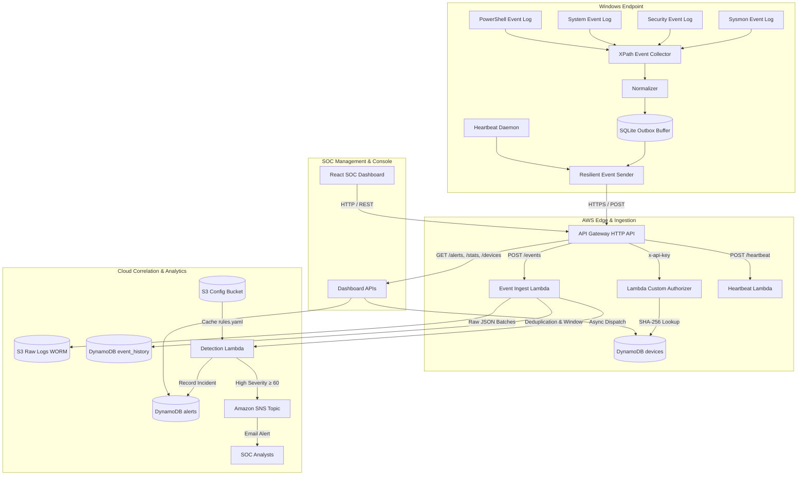

# Windows Log-Based Browser Hijack Detector

[](https://github.com/Rahilbhoot/WebBased_Hijack_Detector/actions)
[](https://www.python.org/)
[](https://www.terraform.io/)
[](https://react.dev/)
[](LICENSE)

An enterprise-grade hybrid security monitoring and detection platform designed to detect, correlate, and alert on browser hijacking attacks in Windows environments using native event logs (**Sysmon**, **Security**, **System**, **PowerShell**) and AWS serverless analytics.

---

## 1. About the Project

Browser hijackers frequently bypass traditional signature-based antivirus solutions by manipulating legitimate operating system features rather than executing binary malware payloads. These stealth techniques include injecting proxy flags into browser shortcut target paths (`.lnk`), forcing malicious homepages via Group Policy registry keys, tampering with the system `hosts` file, or installing persistent scheduled tasks.

The **Windows Log-Based Browser Hijack Detector** delivers end-to-end endpoint visibility and threat detection through three tightly integrated components:

1. **Windows Endpoint Agent (Python / Windows Service)**:
   - **Zero-Polling Kernel Collection**: Consumes events via native kernel-level XPath bookmarks across Security, System, Sysmon, and PowerShell channels with minimal CPU overhead (<1.2%).
   - **Offline Outbox Buffer**: Built-in SQLite WAL-mode queue prevents event loss during network disconnections and drains automatically once connectivity returns.
   - **Local Pre-Filtering & Normalization**: Standardizes diverse Windows XML schemas into uniform JSON representations and evaluates heuristics locally before transmission.

2. **AWS Serverless Cloud Pipeline**:
   - **Ingestion & Auth**: High-throughput Amazon API Gateway HTTP API paired with a Lambda custom authorizer verifying hashed API keys against Amazon DynamoDB.
   - **WORM Audit Immutability**: Batches raw event JSONs into Amazon S3 with **Object Lock Compliance Mode** (90-day retention) for tamper-proof forensic auditing.
   - **Serverless Detection & Correlation**: AWS Lambda evaluates atomic rules and queries a sliding-window DynamoDB history to detect multi-stage chained attack sequences.
   - **Automated Alerting**: Real-time email and webhook alerts for High-severity incidents via Amazon SNS.

3. **Modern SOC Web Dashboard (React 18 + Vite)**:
   - Cyber-themed dark mode console with glassmorphism panels.
   - Live **Alerts Explorer** with 8-second auto-refresh, search filters, and severity indicators.
   - **Incident Dossier**: Detailed threat narratives, MITRE ATT&CK badges, forensic evidence, and interactive **±10-minute correlated event timelines**.
   - **Endpoints Fleet**: Live device heartbeat status, uptime monitoring, and instant one-click API key revocation.

---

## 2. Architecture Diagram



---

## 3. Detection Rules & MITRE ATT&CK Matrix

### Atomic Heuristics (`rules/rules.yaml`)
| Rule ID | Threat Name | Event Source | MITRE ATT&CK | Score | Detection Logic |
|---|---|---|---|---|---|
| **BH001** | Suspicious Browser Flags | Sysmon 1 / Sec 4688 | [T1090](https://attack.mitre.org/techniques/T1090/), [T1176](https://attack.mitre.org/techniques/T1176/) | 40 | Browser launched with `--proxy-server`, `--load-extension`, or `--user-data-dir` |
| **BH002** | Browser Policy Hijack | Sysmon 13 / Sec 4657 | [T1112](https://attack.mitre.org/techniques/T1112/) | 50 | Registry keys modified under `Policies\Google\Chrome` or `Policies\Microsoft\Edge` |
| **BH003** | System Proxy Altered | Sysmon 13 / Sec 4657 | [T1090](https://attack.mitre.org/techniques/T1090/) | 30 | Tampering with `Internet Settings\ProxyServer` or `AutoConfigURL` |
| **BH004** | Hosts File Modified | Sysmon 11 / Sec 4663 | [T1565.001](https://attack.mitre.org/techniques/T1565/001/) | 40 | Unauthorized modification of `C:\Windows\System32\drivers\etc\hosts` |
| **BH005** | Browser Shortcut Tampered | Sysmon 11 | [T1547.009](https://attack.mitre.org/techniques/T1547/009/) | 30 | Modification of desktop or Start Menu `.lnk` shortcut files |
| **BH006** | Persistence Task/Service | Security 4698 / Sys 7045 | [T1053.005](https://attack.mitre.org/techniques/T1053/005/) | 35 | Scheduled tasks or Windows services created to run browser commands |
| **BH007** | Security Log Cleared | Security 1102 / Sys 104 | [T1070.001](https://attack.mitre.org/techniques/T1070/001/) | 60 | Defense evasion indicator: audit event log wiped |
| **BH008** | Root Certificate Injected | Sysmon 13 / Sec 4657 | [T1553.004](https://attack.mitre.org/techniques/T1553/004/) | 45 | Certificate added to `ROOT\Certificates` (HTTPS interception) |

### Multi-Stage Correlation Chains (`rules/correlation_rules.yaml`)
| Chain ID | Sequence Description | Required Events | Time Window | Bonus | Total Score |
|---|---|---|---|---|---|
| **CR01** | Policy modified followed by browser launch | `BH002` &rarr; `BH001` | 300s (5 min) | **+30** | **70 (High)** |
| **CR02** | Proxy redirection combined with hosts tampering | `BH003` + `BH004` | 600s (10 min) | **+25** | **65 (High)** |
| **CR03** | Attack activity followed by security log wipe | `BH*` &rarr; `BH007` | 600s (10 min) | **+30** | **90 (High)** |

---

## 4. Quick Start: Setting Up After Cloning

Follow this step-by-step guide to run the full platform from scratch.

### Prerequisites
- **Operating System**: Windows 10/11 or Windows Server 2022 (x64)
- **Python**: Version **3.11+** installed and added to PATH
- **Node.js**: Version **18+** (with npm)
- **AWS CLI**: Installed and configured (`aws configure`)
- **Terraform**: Version **1.6+** installed and added to PATH

---

### Step 1: Clone Repository & Create Virtual Environment
Open PowerShell or your preferred terminal:

```powershell
git clone https://github.com/Rahilbhoot/WebBased_Hijack_Detector.git
cd WebBased_Hijack_Detector

# Create and activate Python virtual environment
python -m venv .venv
.\.venv\Scripts\Activate.ps1

# Install Python packages in editable development mode
pip install -e .[dev,cloud]
```

---

### Step 2: Deploy Cloud Infrastructure with Terraform
Deploy the serverless backend (API Gateway, DynamoDB tables, S3 buckets, and Lambda functions) to AWS:

```powershell
cd cloud/terraform

# Initialize Terraform providers
terraform init

# Deploy infrastructure (takes ~2 minutes)
terraform apply -auto-approve
```

At the end of the deployment, Terraform will output values like:
```text
api_gateway_endpoint = "https://<api-id>.execute-api.ap-south-1.amazonaws.com"
dynamodb_alerts_table = "hijack-detector-dev-alerts"
```

Copy the `api_gateway_endpoint` value and return to the root folder:
```powershell
cd ../..
```

---

### Step 3: Configure Environment Variables
1. **Root `.env` Configuration** (Used by the Agent and Simulation Scripts):
   Copy `.env.example` to `.env`:
   ```powershell
   Copy-Item .env.example .env
   ```
   Open `.env` and fill in your details:
   ```ini
   DEVICE_ID=PC-LAB-01
   API_ENDPOINT=https://<api-id>.execute-api.ap-south-1.amazonaws.com
   API_KEY=
   ```

2. **Dashboard `.env` Configuration**:
   Create or edit `dashboard/.env`:
   ```ini
   VITE_API_ENDPOINT=https://<api-id>.execute-api.ap-south-1.amazonaws.com
   ```

---

### Step 4: Enroll Your Device & Generate API Key
Register your local machine into the fleet registry to obtain an API key:

```powershell
python scripts/enroll_device.py --device-id PC-LAB-01
```
*(The script will enroll `PC-LAB-01` into DynamoDB and automatically save the generated `API_KEY` into your `.env` file.)*

---

### Step 5: Start the Endpoint Agent Daemon
In **Terminal 1**, start the background agent service:

```powershell
python -m agent
```
You will see:
```text
[INFO] Initializing Hijack Detector Agent Service for device 'PC-LAB-01'.
[INFO] HeartbeatService started (interval=120s).
[INFO] Agent event collection loop running.
[INFO] Heartbeat delivered successfully for device 'PC-LAB-01'.
```
*(Keep this terminal running. It monitors Windows Event Logs in real time and streams telemetry to AWS.)*

---

### Step 6: Start the SOC Web Dashboard
In **Terminal 2**, start the React dashboard development server:

```powershell
cd dashboard
npm install
npm run dev
```

Open your browser at **[http://localhost:3000](http://localhost:3000)**.
- Navigate to **Alerts Explorer** ([http://localhost:3000/alerts](http://localhost:3000/alerts)).
- Navigate to **Endpoints Fleet** ([http://localhost:3000/devices](http://localhost:3000/devices)) to see `PC-LAB-01` reported **Online**.

---

### Step 7: Simulate Attacks & Observe Real-Time Detections
In **Terminal 3**, run simulated attack scenarios to see alerts populate the dashboard:

#### Option A: Direct Telemetry Injector (Fastest & Zero Setup)
Simulates any attack without requiring elevated privileges:

```powershell
# Simulate a correlated multi-stage attack (CR01 - High Severity):
python scripts/inject_simulated_attack.py --scenario CR01

# Simulate all attack scenarios (BH001, BH002, BH003, BH004, BH006, CR01):
python scripts/inject_simulated_attack.py --scenario ALL
```

#### Option B: Real Windows OS Process & Registry Simulation
Executes actual processes and registry changes on your machine:

```powershell
powershell.exe -ExecutionPolicy Bypass -File .\scripts\simulate_attacks.ps1 -Attack 1
```

Watch Terminal 1 log the local detection, transmit the batch to AWS, and see the new incident card stream into **[http://localhost:3000/alerts](http://localhost:3000/alerts)** in real time!

---

## 5. Operating Modes

The endpoint agent can be operated in three distinct modes:

### Mode 1: Cloud-Connected Daemon (Recommended)
Streams telemetry to AWS API Gateway, benefits from serverless correlation, and surfaces alerts in the web dashboard:
```powershell
python -m agent
```

### Mode 2: Standalone Local Mode (100% Offline)
Runs entirely on the local machine with zero external network connectivity. Heuristics are evaluated locally and stored in SQLite:
```powershell
python -m agent.standalone
```
*(Alerts are logged to console and saved in `data/local_alerts.sqlite`.)*

### Mode 3: Windows Service (Production Auto-Start)
Installs the agent as a resilient, auto-recovering Windows Service via NSSM:
```powershell
# Run elevated as Administrator:
powershell.exe -ExecutionPolicy Bypass -File .\agent\installer\install_service.ps1
```

---

## 6. Testing & Quality Assurance

Run the comprehensive automated test suite and code linters:

```powershell
# Run all unit and integration tests (128+ passing tests)
pytest -v

# Run fast code formatting and linting
ruff check .

# Validate Terraform IaC configuration
cd cloud/terraform
terraform validate
```

---

## 7. Project Structure

```text
hijack-detector/
├── .github/                      # CI/CD Workflows (Testing, Deployment, Dependabot)
│   ├── workflows/ci.yml          # Automated pytest, ruff lint, & terraform validation
│   └── workflows/deploy-infra.yml# GitHub Actions AWS OIDC deployment pipeline
├── agent/                        # Windows Endpoint Agent Core
│   ├── __main__.py               # CLI entrypoint for `python -m agent`
│   ├── collector.py              # Kernel XPath Windows Event Log reader
│   ├── normalizer.py             # XML schema normalization engine
│   ├── rule_engine.py            # Local heuristic matching & scoring
│   ├── correlator.py             # Multi-stage sliding-window correlator
│   ├── sender.py                 # HTTPS batching with SQLite buffering
│   ├── heartbeat.py              # Endpoint health telemetry service
│   ├── local_store.py            # Thread-safe SQLite WAL persistence
│   └── service.py                # Unified agent service loop
├── cloud/                        # Cloud Infrastructure & Microservices
│   ├── lambda/                   # Serverless Lambda handlers
│   │   ├── ingest.py             # POST /events ingestion & S3 WORM archive
│   │   ├── detect.py             # Serverless correlation & alert generator
│   │   ├── heartbeat.py          # POST /heartbeat & silence detection
│   │   ├── authorizer.py         # Custom API Gateway key validator
│   │   ├── api_alerts.py         # GET /alerts & GET /alerts/{id}
│   │   ├── api_devices.py        # Fleet device management & enrollment
│   │   ├── api_stats.py          # Fleet overview & 24h metrics aggregation
│   │   └── api_rules.py          # Threat catalog & whitelist API
│   └── terraform/                # Infrastructure as Code (AWS ap-south-1)
│       ├── api_gateway.tf        # HTTP API & route definitions
│       ├── lambda.tf             # Functions, IAM policies, and CloudWatch
│       ├── dynamodb.tf           # Alerts, devices, and event history tables
│       ├── s3.tf                 # WORM raw log bucket & config bucket
│       └── dashboard_api.tf      # SOC dashboard REST endpoints
├── dashboard/                    # React 18 + Vite SOC Dashboard
│   ├── src/pages/                # Overview, Alerts Explorer, AlertDetail, Devices
│   ├── src/components/           # Navbar, IncidentCards, MetricBadges
│   └── src/api/client.js         # API Gateway HTTP client
├── rules/                        # Threat Detection Rules
│   ├── rules.yaml                # Atomic heuristics (BH001 - BH008)
│   ├── correlation_rules.yaml    # Chained attack sequences (CR01 - CR03)
│   └── whitelist.yaml            # Trusted binaries and updater paths
├── scripts/                      # Setup & Attack Simulation Utilities
│   ├── enroll_device.py          # Automated device enrollment & key generator
│   ├── inject_simulated_attack.py# Direct attack telemetry injector
│   ├── simulate_attacks.ps1      # Native Windows OS attack simulator
│   └── setup_lab_auditing.ps1    # Automated Windows audit policy configurator
└── tests/                        # 128 Automated Unit & Integration Tests
    ├── unit/                     # Collector, normalizer, rule engine, & outbox tests
    └── integration/              # End-to-end cloud pipeline & resilience tests
```

---

## 8. License

This project is licensed under the MIT License. See [LICENSE](LICENSE) for details.

## 9. Team
1. RahilBhoot
2. AnujBansal
