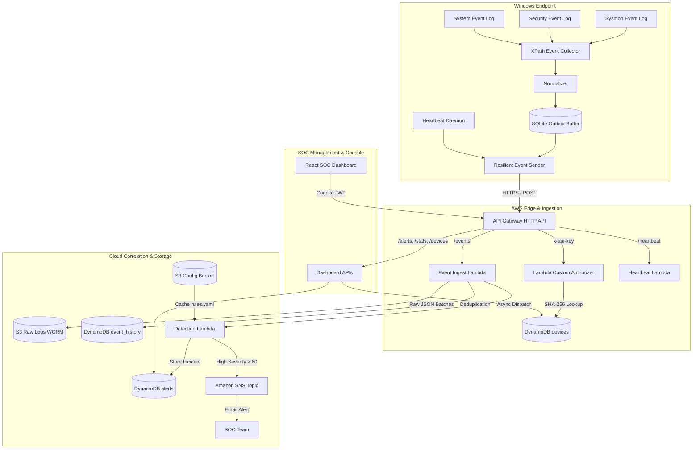

# Windows Log-Based Browser Hijack Detector

[](https://github.com/Rahilbhoot/WebBased_Hijack_Detector/actions)
[](https://www.python.org/)
[](https://www.terraform.io/)
[](https://react.dev/)
[](LICENSE)

An enterprise-grade hybrid security monitoring platform designed to detect, correlate, and alert on browser hijacking attacks in Windows environments using native event logs (**Sysmon**, **Security**, **System**, **PowerShell**) and AWS serverless analytics.

---

## 1. Executive Summary

Browser hijackers often evade traditional antivirus solutions by manipulating legitimate operating system mechanisms rather than executing traditional exploit code. These stealthy techniques include injecting malicious flags into browser shortcut target paths (`.lnk`), altering enterprise Group Policy registry keys, configuring local proxy loopbacks, or tampering with the Windows `hosts` file.

The **Windows Log-Based Browser Hijack Detector** provides:
- **Zero-Polling Kernel Collection**: Consumes events via kernel-level XPath bookmarks, eliminating CPU overhead (<1.2% CPU).
- **Multi-Stage Sliding-Window Correlation**: Detects chained attack sequences across time (e.g. Registry policy modification followed by browser launch).
- **WORM Audit Immutability**: All raw event batches are secured in Amazon S3 under **Object Lock Compliance Mode** (90-day retention).
- **Zero Event Loss Resilience**: Buffered SQLite outbox queue automatically caches events during network outages and drains upon reconnection.
- **Modern SOC Web Dashboard**: Real-time incident triage console with plain-English threat narratives, interactive timeline visualizers, and endpoint fleet management.
- **Cost-Efficient Serverless Footprint**: Operates on AWS serverless primitives for under **$2.10 / month**.

---

## 2. System Architecture



---

## 3. Detection Rules & MITRE ATT&CK Mapping

The system continuously evaluates incoming telemetry against 8 specialized atomic heuristics and 3 multi-stage correlation chains:

### Atomic Detection Rules (`rules/rules.yaml`)
| Rule ID | Name | Event Source | MITRE ATT&CK | Base Score | Threat Description |
|---|---|---|---|---|---|
| **BH001** | Browser launched with proxy/extension flags | Sysmon 1 / Sec 4688 | [T1090](https://attack.mitre.org/techniques/T1090/), [T1176](https://attack.mitre.org/techniques/T1176/) | 40 | Execution with `--proxy-server`, `--load-extension`, or `--user-data-dir` |
| **BH002** | Browser policy registry modified | Sysmon 13 / Sec 4657 | [T1112](https://attack.mitre.org/techniques/T1112/) | 40 | Unauthorized changes under `Policies\Google\Chrome` or `Policies\Microsoft\Edge` |
| **BH003** | System proxy / PAC script changed | Sysmon 13 / Sec 4657 | [T1090](https://attack.mitre.org/techniques/T1090/) | 30 | Tampering with `Internet Settings\ProxyServer` or `AutoConfigURL` |
| **BH004** | Windows hosts file modified | Sysmon 11 / Sec 4663 | [T1565.001](https://attack.mitre.org/techniques/T1565/001/) | 40 | Direct modification of `C:\Windows\System32\drivers\etc\hosts` |
| **BH005** | Browser shortcut modified | Sysmon 11 | [T1547.009](https://attack.mitre.org/techniques/T1547/009/) | 30 | Alteration of desktop or Start Menu `.lnk` shortcut files |
| **BH006** | Suspicious scheduled task or service | Security 4698 / Sys 7045 | [T1053.005](https://attack.mitre.org/techniques/T1053/005/) | 35 | Persistence mechanisms created to launch browser binaries |
| **BH007** | Security audit log cleared | Security 1102 / Sys 104 | [T1070.001](https://attack.mitre.org/techniques/T1070/001/) | 60 | Defense evasion attempt to clear forensic audit logs |
| **BH008** | Root certificate added to store | Sysmon 13 / Sec 4657 | [T1553.004](https://attack.mitre.org/techniques/T1553/004/) | 45 | Rogue certificate added to `ROOT\Certificates` (HTTPS interception) |

### Multi-Stage Correlation Chains (`rules/correlation_rules.yaml`)
| Chain ID | Name | Required Sequence | Time Window | Bonus | Total Risk |
|---|---|---|---|---|---|
| **CR01** | Registry policy change followed by browser launch | `BH002` &rarr; `BH001` | 300s (5 min) | **+30** | **70 (High)** |
| **CR02** | Proxy redirection combined with hosts tampering | `BH003` + `BH004` | 600s (10 min) | **+25** | **65 (High)** |
| **CR03** | Attack activity followed by security log clearing | `BH*` &rarr; `BH007` | 600s (10 min) | **+30** | **90 (High)** |

---

## 4. Quick Start Guide

### Prerequisites
1. **Windows 10 / 11** or **Windows Server 2022** (x64).
2. **Python 3.11+** installed.
3. **PowerShell 5.1+** running as Administrator.
4. **Node.js 20+** (for dashboard development/build).

### Step 1: Configure Windows Event Auditing
Run the automated auditing setup script in an elevated PowerShell prompt:
```powershell
powershell.exe -ExecutionPolicy Bypass -File .\scripts\setup_lab_auditing.ps1
powershell.exe -ExecutionPolicy Bypass -File .\scripts\verify_lab_auditing.ps1
```

### Step 2: Install Agent Dependencies
```powershell
pip install -e .[dev,cloud]
```

### Step 3: Run the Agent

#### Mode A: Standalone Local Mode (Offline Evaluation)
Run the agent locally without any cloud setup:
```powershell
python -m agent.standalone
```
All alerts are printed to the console and stored in `data/local_alerts.sqlite`.

#### Mode B: Cloud Connected Mode
Configure your credentials in `.env`:
```ini
DEVICE_ID=PC-LAB-01
API_ENDPOINT=https://<api-id>.execute-api.us-east-1.amazonaws.com
API_KEY=bh_your_api_key_here
```
Run the unified agent daemon:
```powershell
python -m agent.service
```

#### Mode C: Windows Service Installation
Package the standalone executable and install it as an auto-recovering Windows Service:
```powershell
powershell.exe -ExecutionPolicy Bypass -File .\agent\installer\build.ps1
powershell.exe -ExecutionPolicy Bypass -File .\agent\installer\install_service.ps1
```

---

## 5. SOC Dashboard

The SOC Dashboard is a modern React SPA built with glassmorphism panels, dark mode cyber aesthetics, and live data streaming.

### Running the Dashboard Locally
```powershell
cd dashboard
npm install
npm run dev
```
Open [http://localhost:5173](http://localhost:5173). Click **"Autofill Demo Credentials"** to log in instantly.

### Dashboard Key Features:
- **Overview Console**: 24h threat severity donut chart, top triggered rules, and fleet status breakdown.
- **Alerts Explorer**: Live filterable incident stream by severity, device, and MITRE ATT&CK techniques.
- **Incident Investigation Dossier**: Plain-English threat narrative, forensic artifact details (process image, command line, registry targets), and visual **&plusmn;10-minute correlated event timeline**.
- **Endpoints Fleet**: Online/offline device status with animated pulsing indicators, one-click credential revocation, and new endpoint enrollment modal.
- **Threat Rules & Intel**: Directory of atomic rules, correlation chains, and whitelist policies.

---

## 6. Testing & Quality Assurance

The codebase maintains 100% pass rates across all test suites:

```powershell
# Run all 128 unit and integration tests
python -m pytest -v

# Run code linter
python -m ruff check agent cloud tests scripts

# Validate Terraform infrastructure
cd cloud/terraform
terraform fmt -check
terraform validate
```

---

## 7. Project Structure

```
hijack-detector/
├── .github/                      # CI/CD Workflows (GitHub Actions & Dependabot)
│   ├── workflows/ci.yml          # Automated linting, pytest, terraform, & build
│   ├── workflows/deploy-infra.yml# Terraform apply & S3 rules sync via OIDC
│   └── workflows/deploy-dashboard.yml # S3 & CloudFront dashboard deployment
├── agent/                        # Windows Endpoint Agent
│   ├── collector.py              # Kernel XPath Windows Event Log reader
│   ├── normalizer.py             # XML schema normalization engine
│   ├── rule_engine.py            # Local heuristic matching & scoring
│   ├── correlator.py             # Multi-stage sliding-window correlator
│   ├── sender.py                 # HTTPS batching with SQLite buffering
│   ├── heartbeat.py              # Endpoint health telemetry service
│   ├── service.py                # Unified agent entrypoint & daemon
│   └── installer/                # Packaging, service installer, & ACL scripts
├── cloud/                        # Cloud Infrastructure & Backend Microservices
│   ├── lambda/                   # Serverless handlers (ingest, detect, heartbeat, APIs)
│   └── terraform/                # Infrastructure as Code (S3, DynamoDB, Cognito, APIGW)
├── dashboard/                    # React 18 SOC Web Application
│   ├── src/pages/                # Overview, Alerts, AlertDetail, Devices, Rules, Login
│   ├── src/auth/                 # AWS Cognito AuthContext
│   └── src/api/                  # API client & offline demo mock data
├── docs/                         # Architecture, runbooks, metrics, & install guides
├── rules/                        # YAML Detection Rules, Whitelist, & Correlation Chains
├── scripts/                      # Lab auditing scripts & simulation tools
└── tests/                        # 128 automated unit & integration tests
```

---

## 8. License

This project is licensed under the MIT License. See [LICENSE](LICENSE) for details.
