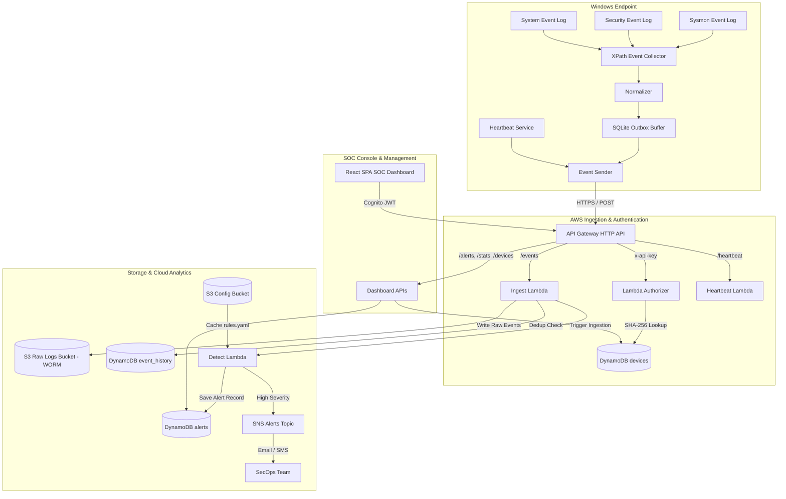

# System Architecture Deep Dive

The **Windows Log-Based Browser Hijack Detector** is a hybrid security monitoring platform comprising a lightweight, kernel-event Windows endpoint agent and an AWS serverless cloud analytics pipeline.

---

## 1. High-Level Architecture Diagram

---

## 2. Windows Endpoint Subsystems

1. **XPath Event Collector (`agent/collector.py`)**:
   - Queries Windows Event Log channels using kernel-level XPath filter expressions.
   - Prevents polling overhead by filtering only target Event IDs (Sysmon 1, 11, 12, 13, 14; Security 4688, 4698, 1102; System 7045).
   - Maintains an atomic `bookmarks.json` file on disk. On restart, collection resumes exactly where it left off.
2. **Event Normalizer (`agent/normalizer.py`)**:
   - Translates dissimilar XML structures from Sysmon, Security, and System logs into a uniform Pydantic schema: `NormalizedEvent`.
   - Cleans process paths, parses registry hive abbreviations, and standardizes timestamps to ISO 8601 UTC.
3. **Local Outbox Queue (`agent/local_store.py`)**:
   - High-performance SQLite database (`queue.sqlite`) operating in WAL (Write-Ahead Logging) mode.
   - Incoming events are committed locally before network transmission. If network connectivity drops, events accumulate safely without memory bloat.
4. **Heartbeat Service (`agent/heartbeat.py`)**:
   - Background thread transmitting device status, host metrics, and queue depth every 2 minutes.

---

## 3. Cloud Data Pipeline & Schema Design

### DynamoDB Table Schemas

#### 1. `alerts` Table
- **Partition Key**: `device_id` (String)
- **Sort Key**: `timestamp` (String, ISO 8601 UTC)
- **Attributes**: `alert_id`, `rule_ids` (List), `score` (Number), `severity` (String: High/Medium/Low), `explanation` (String), `mitre_ids` (List), `raw_event` (Map), `ttl` (Number).
- **GSI**: `SeverityIndex` (PK: `severity`, SK: `timestamp`) for fast incident sorting in the dashboard.

#### 2. `devices` Table
- **Partition Key**: `device_id` (String)
- **Attributes**: `api_key_hash` (String, SHA-256), `status` (String: Online/Offline/Revoked), `last_seen` (String), `last_seen_epoch` (Number), `hostname` (String), `os_version` (String), `agent_version` (String), `ip_address` (String), `event_queue_size` (Number), `total_events_sent` (Number).
- **GSI**: `ApiKeyHashIndex` (PK: `api_key_hash`) enabling O(1) device authorization lookups.

#### 3. `event_history` Table (Sliding Window & Dedup)
- **Partition Key**: `device_id` (String)
- **Sort Key**: `event_id` (String)
- **Attributes**: `timestamp` (String), `timestamp_epoch` (Number), `event_hash` (String), `ttl` (Number - 24 hour automatic expiration).

---

## 4. Security & Compliance Architecture

1. **WORM Raw Log Storage (Write Once, Read Many)**:
   - S3 Object Lock is enabled in Compliance mode on `hijackdet-<env>-rawlogs-*`.
   - Raw batches uploaded by the ingestion Lambda cannot be overwritten or deleted by any IAM principal (including AWS root) for 90 days.
2. **Authentication Boundary**:
   - Endpoint traffic is validated at the edge by the Lambda Custom Authorizer before reaching business logic.
   - Raw API keys are never stored; only one-way SHA-256 digests exist in DynamoDB.
   - Dashboard endpoints are protected by **Amazon Cognito** user pool authorizers validating RSA-signed JWT ID tokens.
3. **Least Privilege IAM Roles**:
   - Each Lambda has a strictly isolated execution role with explicit resource ARN boundaries. Wildcard `*` actions on S3 and DynamoDB are forbidden.
