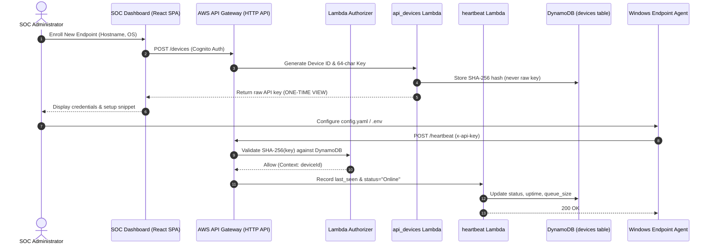
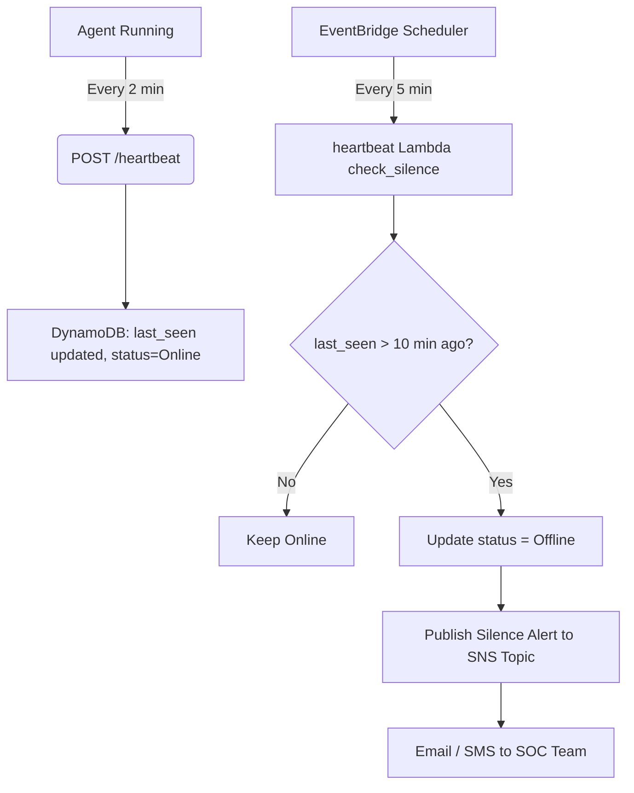

# Endpoint Device Onboarding & Credential Lifecycle Guide

This guide details the complete device lifecycle for the **Windows Log-Based Browser Hijack Detector**, including initial endpoint registration, secure API key provisioning, agent deployment, heartbeat reporting, credential rotation, and silence monitoring.

---

## 1. Architecture Overview



---

## 2. Step-by-Step Onboarding Flow (< 10 Minutes)

### Step 1: Endpoint Auditing Prerequisites
Before launching the agent, configure Windows event telemetry:
1. Open PowerShell as Administrator.
2. Execute the automated lab auditing script:
   ```powershell
   powershell.exe -ExecutionPolicy Bypass -File .\scripts\setup_lab_auditing.ps1
   ```
3. Verify auditing policies and Sysmon logging:
   ```powershell
   powershell.exe -ExecutionPolicy Bypass -File .\scripts\verify_lab_auditing.ps1
   ```

### Step 2: Register Device in SOC Console
1. Navigate to the SOC Dashboard (e.g. `http://localhost:5173/devices` or CloudFront URL).
2. Click **"Enroll New Endpoint"**.
3. Enter the target machine's identifier:
   - **Hostname**: `PC-LAB-01` (or click auto-detect).
   - **Operating System**: `Windows 11 Pro 23H2`.
4. Click **"Generate API Key & Enroll"**.
5. Copy the displayed **One-Time API Key** immediately. 
   > [!IMPORTANT]
   > For zero-trust security, the raw key is never stored on the server. Only its SHA-256 hash is retained in the DynamoDB `devices` table.

### Step 3: Configure Endpoint Agent
Configure the credentials on the endpoint via environment variables or `agent/config.yaml`:

#### Option A: Using `.env` (Recommended)
Create or update `.env` in the project root:
```ini
DEVICE_ID=PC-LAB-01
API_ENDPOINT=https://<api-gateway-id>.execute-api.us-east-1.amazonaws.com
API_KEY=bh_a1b2c3d4e5f6...
```

#### Option B: Direct `agent/config.yaml`
```yaml
device_id: "PC-LAB-01"
api_endpoint: "https://<api-gateway-id>.execute-api.us-east-1.amazonaws.com"
api_key: "bh_a1b2c3d4e5f6..."
heartbeat_interval_seconds: 120
poll_interval_seconds: 5
```

If `device_id` is left empty or set to `AUTO`, the agent automatically infers the identifier using the host's Windows computer name: `PC-<HOSTNAME>`.

### Step 4: Start the Agent & Verify Heartbeat
Start the agent service:
```powershell
python -m agent.standalone
# Or in cloud connected mode:
python -m agent.collector
```

Within **5 seconds**, the agent sends an initial startup heartbeat. Check the dashboard:
- The endpoint card displays a glowing green **"Online"** status pill.
- The **"Last Heartbeat"** timestamp updates in real time.

---

## 3. Credential Rotation Flow (Key Rotation)

When an API key must be rotated due to scheduled security policy or potential compromise:

### Administrative Re-generation
1. In the SOC Dashboard under **Endpoints Fleet**, select the target device.
2. Trigger key re-generation via `POST /devices` with the same `device_id`:
   ```bash
   curl -X POST https://<api-endpoint>/devices \
     -H "Authorization: Bearer <cognito-jwt>" \
     -H "Content-Type: application/json" \
     -d '{"device_id": "PC-LAB-01", "hostname": "PC-LAB-01"}'
   ```
3. A newly generated 64-character hexadecimal key is returned, and its new SHA-256 hash replaces the previous hash in DynamoDB.
4. Update the endpoint's `.env` or `config.yaml` with the new key.
5. The next heartbeat immediately authenticates with the new credential.

### Revoking Compromised Credentials
If a machine is retired, stolen, or compromised:
1. In the SOC Dashboard, click **"Revoke"** next to the endpoint (or issue `DELETE /devices/{id}/key`).
2. The DynamoDB record status transitions to `"Revoked"`.
3. The Lambda Custom Authorizer immediately rejects all subsequent requests from this device with `401 Unauthorized` / `403 Forbidden`.
4. The agent's heartbeat loop logs a warning:
   ```
   [ERROR] Heartbeat rejected (HTTP 401/403): Invalid or revoked API key.
   ```

---

## 4. Silence Monitoring & Automated Alerting

Endpoints transmit a heartbeat every **120 seconds** (2 minutes).



- **Threshold**: 10 minutes without a heartbeat (`SILENCE_THRESHOLD_SECONDS = 600`).
- **Detection**: AWS EventBridge invokes the `heartbeat` Lambda every 5 minutes.
- **Action**: Devices exceeding the 10-minute silence threshold are marked `Offline` in DynamoDB, and an urgent incident notification is published to the Amazon SNS alerts topic.
