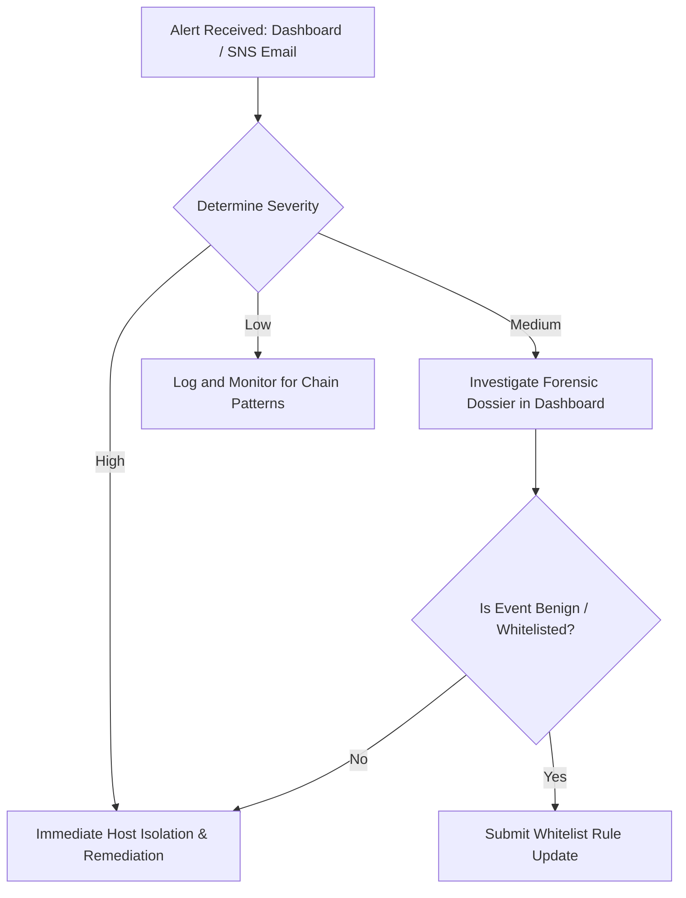

# Security Operations Center (SOC) Operational Runbook

This runbook outlines standard operating procedures (SOPs) for SOC analysts and engineers managing the **Windows Log-Based Browser Hijack Detector**.

---

## 1. Incident Triage Workflow



### Triage Checklist for High-Severity Alerts
1. **Open Incident in Dashboard**: Navigate to `/alerts/<alert_id>` to view the forensic dossier.
2. **Review Narrative & MITRE ATT&CK Mapping**:
   - `BH001` + `CR01`: Attacker modified browser policy in registry and launched Chrome with `--proxy-server` or `--load-extension`.
   - `BH004` + `CR02`: DNS redirection attempt via unauthorized modification to `C:\Windows\System32\drivers\etc\hosts`.
   - `BH007` + `CR03`: Defense evasion indicator — audit log cleared shortly after attack.
3. **Inspect Correlated Timeline**: Examine events within the &plusmn;10-minute window to identify the parent dropper binary and user account context.
4. **Endpoint Remediation**:
   - Kill rogue parent process identified in the forensic card.
   - Revert registry alterations under `HKLM\SOFTWARE\Policies\Google\Chrome` or `Internet Settings`.
   - Restore default Windows hosts file.

---

## 2. Adding a New Detection Rule

1. Open `rules/rules.yaml`.
2. Add the rule definition following the schema:
   ```yaml
   - id: "BH009"
     name: "Chrome default search provider hijacked"
     description: "Detects unauthorized modifications to the default search engine policy"
     event_type: ["registry_set", "registry_add"]
     conditions:
       - field: "registry_key"
         match: "contains"
         values: ["Policies\\Google\\Chrome\\DefaultSearchProvider"]
     base_score: 40
     mitre_ids: ["T1112"]
     explanation_template: >
       Chrome default search provider policy was modified: {registry_key}.
       This forces the browser to redirect web queries to an unauthorized search engine (MITRE T1112).
   ```
3. Commit and merge to `main`.
4. The GitHub Actions deployment pipeline (`deploy-infra.yml`) will automatically validate the rules and upload the updated YAML to the S3 configuration bucket. The Detection Lambda immediately reloads the new rule on its next invocation.

---

## 3. Troubleshooting Endpoint Agent

### Issue: Endpoint Shows "Offline" in Dashboard
1. Verify the Windows Service status on the target machine:
   ```powershell
   Get-Service -Name HijackDetectorAgent
   ```
2. If stopped, inspect the logs:
   ```powershell
   Get-Content "C:\Program Files\HijackDetector\logs\agent.log" -Tail 50
   ```
3. Common causes:
   - **Invalid API Key**: Log displays `Heartbeat rejected (HTTP 401/403)`. Solution: Re-enroll the endpoint via the dashboard and update `config.yaml`.
   - **Network Egress Blocked**: Ensure HTTPS connectivity to the API Gateway:
     ```powershell
     Test-NetConnection -ComputerName <api-id>.execute-api.us-east-1.amazonaws.com -Port 443
     ```
   - **Service Crash**: The service is configured to automatically restart after 5s, 30s, and 60s. Check `logs\service_stderr.log` for unhandled exceptions.

### Issue: High Event Queue Backlog
If the endpoint outbox queue is growing (`event_queue_size > 100`):
1. Check internet connectivity. The agent automatically buffers events in `data\queue.sqlite` during outages.
2. Once connectivity is restored, the agent automatically drains buffered batches in rate-limited chunks.
